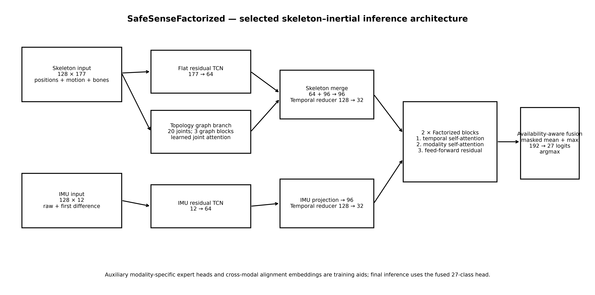
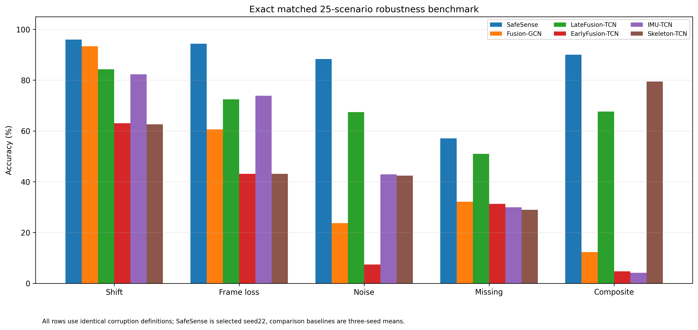
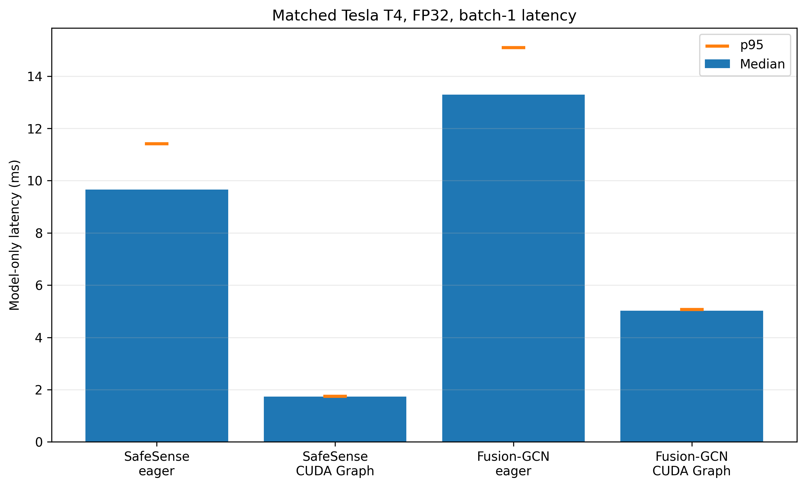

# SafeSense
### Robust and Efficient Skeleton–Inertial Human Activity Recognition

A compact PyTorch model for recognizing **27 human activities** from 3D skeleton and IMU signals on **UTD-MHAD**. It combines temporal convolution, a skeleton-graph encoder, and factorized temporal/modality attention.



## Results

| Metric | SafeSense |
| --- | ---: |
| Cross-subject clean accuracy | **96.28%** |
| Macro-F1 | **96.36%** |
| Mean corruption-category accuracy | **85.13%** |
| Parameters | **440,562** |
| Tesla T4 CUDA Graph median latency (batch 1) | **1.732 ms** |

**Evaluation note:** The even-subject results are post-hoc because earlier research iterations had observed that partition. Latency is model-only, not end-to-end camera inference. See [reproducibility and limitations](docs/reproducibility.md).



### Inference latency



## Quick start

Requires **Python 3.10**. Install the pinned runtime and package:

```bash
python3.10 -m venv .venv
source .venv/bin/activate
pip install -r requirements.txt
pip install -e .
```

On Windows, use `.venv\Scripts\activate`.

Download **UTD-MHAD** from its authorized source; raw data and model checkpoints are not redistributed here. Prepare skeleton and inertial recordings:

```bash
safesense prepare-fusion --data-dir data/extracted --output-dir cache/fusion-gcn --expected-count 861
```

### Reproduce the selected model

The frozen model uses seed 22, 60 epochs, and stochastic weight averaging across epochs 45–60. With Modal configured and the dataset available:

```bash
modal run modal_app.py::safesense_factorized_swa_smoke
modal run modal_app.py::safesense_factorized_swa_final
```

These commands require a configured GPU cloud environment and are not one-click local inference. Consult [reproducibility instructions](docs/reproducibility.md).

## Repository layout

```text
assets/           Architecture, robustness and latency figures
docs/             Architecture, data and reproducibility guides
research/         Selected result artifacts
scripts/          Matched-baseline comparison runner
src/safesense/    Model implementation and data/evaluation code
tests/            Automated regression and protocol tests
modal_app.py      Frozen training and evaluation workflows
```

## Testing

After installing the development dependencies:

```bash
pip install -r requirements-dev.txt -r requirements-local.txt
python -m pytest -q
```

## Scope

SafeSense is a **research implementation**, not a general-purpose webcam product. Pretrained weights, a video-to-20-joint pose calibration pipeline, and a packaged video inference API are not included. Its benchmark does not establish real-world webcam accuracy.

The project integrates compatibility logic for the upstream [Fusion-GCN](https://github.com/mduhme/fusion-gcn) baseline; third-party code and UTD-MHAD data remain subject to their own terms. A license for the SafeSense implementation is pending contributor agreement.
